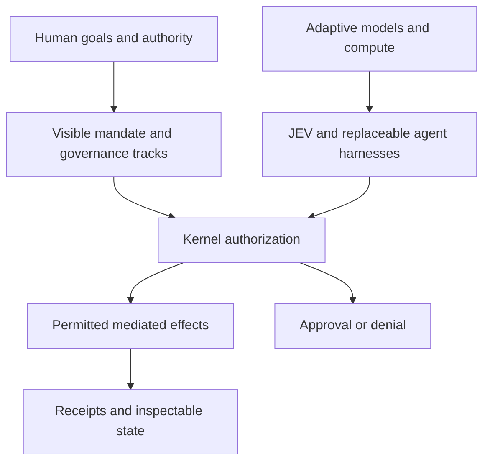

# Human-readable visual governance tracks

The human defines a framework within which adaptive intelligence may act. The interface shows that framework as readable tracks and guardrails, with the actual effective permissions computed from canonical kernel policy.

## Minimum operator view

For each mandate display:

- Purpose and task class, expressed in complete, familiar words.
- Track: **Restricted**, **Review**, or **Autopilot**, with its underlying policy corridor.
- Applicable accounts, data, devices, tools, recipients, and network destinations.
- Limits on duration, spending, frequency, and other bounded resources.
- Which actions require **approval before execution**, which are eligible for **review after execution**, and which are denied.
- Current version, active or revoked state, recent actions, and linked receipts.

The visual track is an explanation of policy state, never an independent grant of authority. The kernel supplies the effective-permission view. An agent can draft a proposed wider track, but expansion remains inactive until the authorized human approves the exact change.

## Governance interactions

1. The human sets a goal and selects or edits a track.
2. Goni shows the resulting concrete permissions and examples of permitted and denied effects.
3. Policy changes show a before-and-after difference in affected resources, actions, recipients, budgets, and approval timing.
4. Changes are verified against the same structured policy contract used by execution.
5. Authorized changes become versioned policy transitions with a receipt.
6. The human can reduce authority or revoke an active mandate and see the effective state.

The visualization must remain understandable when a model is unavailable. Critical permission information should be renderable from stored policy without asking a model to infer what is allowed.

## Conceptual relationship

The diagram is conceptual. It makes the capability-to-authority boundary visible without changing Goni's canonical data, context, control, and execution planes.
